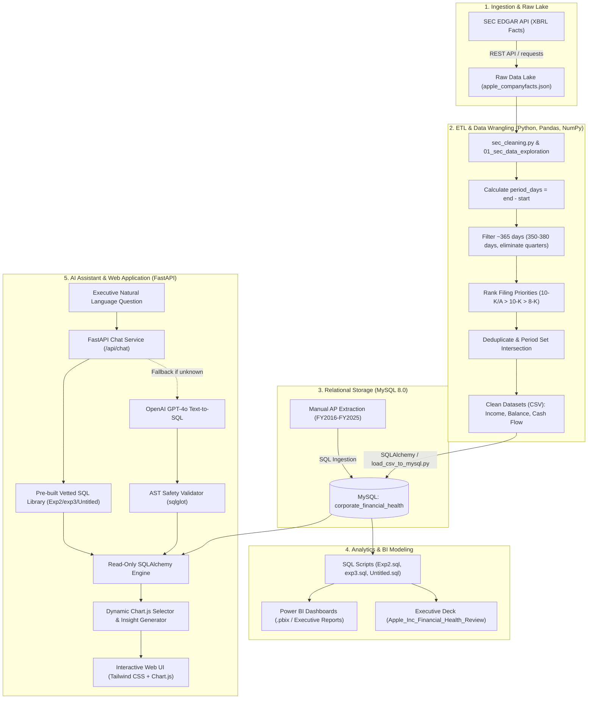

# Corporate Financial Health & Analytics Engine

[](https://www.python.org/)
[](https://pandas.pydata.org/)
[](https://numpy.org/)
[](https://fastapi.tiangolo.com/)
[](https://www.mysql.com/)
[](https://powerbi.microsoft.com/)
[](https://openai.com/)
[](https://opensource.org/licenses/MIT)

An end-to-end financial data engineering, analytics, and business intelligence platform. This project ingests raw XBRL corporate filings from the **U.S. Securities and Exchange Commission (SEC EDGAR API)**, performs rigorous data wrangling and **ETL pipelines** using **Python**, **Pandas**, and **NumPy**, stores relational data models in **MySQL**, executes advanced analytical **SQL** modeling, powers executive **Power BI** dashboards, and serves an interactive **FastAPI** AI-powered financial assistant with dual-engine **Text-to-SQL** capabilities.

---

## 📑 Table of Contents
- [Executive Summary](#-executive-summary)
- [Key Business Questions Answered](#-key-business-questions-answered)
- [Strategic Business Decisions Enabled](#-strategic-business-decisions-enabled)
- [End-to-End System Architecture](#-end-to-end-system-architecture)
- [ETL Pipeline & Data Cleaning Methodology](#-etl-pipeline--data-cleaning-methodology)
- [Financial Analytics & SQL Modeling](#-financial-analytics--sql-modeling)
- [Interactive AI Financial Assistant (FastAPI & Text-to-SQL)](#-interactive-ai-financial-assistant-fastapi--text-to-sql)
- [Power BI Reporting & Executive Presentation](#-power-bi-reporting--executive-presentation)
- [Repository Structure](#-repository-structure)
- [Getting Started & Installation](#-getting-started--installation)
- [Testing & Quality Assurance](#-testing--quality-assurance)

---

## 🎯 Executive Summary

Evaluating corporate financial health requires looking beyond raw top-line numbers. Public financial filings (10-K, 10-Q) in SEC EDGAR contain hundreds of restatements, overlapping periods, and inconsistent reporting tags. 

This platform implements a production-grade analytics workflow focusing on **Apple Inc. (AAPL)** across two decades (FY2007–FY2025):
1. **Automated ETL Pipeline**: Extracts raw JSON XBRL facts, applies mathematical duration filtering, enforces filing priority hierarchies, and normalizes financial statements.
2. **Relational Data Warehouse**: Loads normalized balance sheets, income statements, cash flow statements, and trade accounts payable into **MySQL**.
3. **Advanced SQL Financial Modeling**: Calculates multi-tier margins, working capital dynamics, Cash Conversion Cycles (CCC), liquidity ratios, solvency leverage, and earnings quality indicators.
4. **Interactive AI Copilot**: A **FastAPI** web application featuring a dual-hybrid SQL engine (vetted analytical SQL templates + OpenAI GPT-4o Text-to-SQL fallback) with AST safety validation (`sqlglot`) and dynamic **Chart.js** visualizations.
5. **Executive Decision Support**: Packaged into an interactive Power BI dashboard and executive presentation deck for C-suite decision-makers.

---

## ❓ Key Business Questions Answered

| Domain | Business Question | Financial Metric / Methodology |
|---|---|---|
| **Profitability** | Is revenue growth translating into operational and bottom-line efficiency? | Gross Margin %, Operating Margin %, Net Margin % |
| **Operating Leverage** | Are cost increases in supply chain and production outpacing sales growth? | Year-over-Year (YoY) Margin Compression / Expansion using SQL `LAG()` |
| **Working Capital** | How does Apple generate cash before paying its suppliers? | **Cash Conversion Cycle (CCC)**: $\text{CCC} = \text{DIO} + \text{DSO} - \text{DPO}$ |
| **Supplier Financing** | To what degree does Apple leverage trade credit as an interest-free working capital loan? | Days Payable Outstanding (DPO), AP vs. COGS Ratio |
| **Asset Efficiency** | How rapidly are receivables collected and inventory converted to cash? | Days Sales Outstanding (DSO), Days Inventory Outstanding (DIO) |
| **Solvency & Risk** | Has aggressive share repurchase activity impaired solvency or financial cushion? | Debt-to-Equity Ratio, Debt-to-Assets Ratio, Total Liabilities / Equity |
| **Liquidity** | Can short-term obligations be met without liquidating inventory or long-term assets? | Current Ratio, Quick Ratio, Cash Ratio |
| **Earnings Quality** | Are net profits supported by real cash or driven by non-cash accruals? | Operating Cash Flow to Net Income Ratio ($\text{CFO} / \text{Net Income} \ge 1.0$) |
| **Free Cash Flow** | How much unencumbered cash is generated after sustaining capital expenditures? | Free Cash Flow ($\text{FCF} = \text{Operating Cash Flow} - \text{CapEx}$), CapEx Intensity % |

---

## 💡 Strategic Business Decisions Enabled

1. **Negative Working Capital Moat**:
   - *Discovery*: Apple operates with a **negative Cash Conversion Cycle** (consistently between -50 to -80 days).
   - *Decision*: By collecting cash from customers within ~30–40 days (DSO) while taking 90–115 days to pay suppliers (DPO), Apple uses supplier trade payables as a multi-billion-dollar interest-free working capital facility to fund operations and R&D.

2. **Supply Chain Pricing Power & Margin Resiliency**:
   - *Discovery*: Gross margin expanded from ~38% to over 46% despite global component inflationary pressures.
   - *Decision*: Apple maintains unmatched pricing power in premium hardware and high-margin Services, enabling continued reinvestment in proprietary silicon (Apple Silicon) and customer retention.

3. **Capital Allocation & Debt Optimization**:
   - *Discovery*: Negative shareholder equity in recent years is not an indicator of bankruptcy distress, but a deliberate corporate finance strategy: utilizing exceptionally low-cost corporate debt to fund massive share repurchases ($90B+ annually) while domestic cash flow remains robust.

4. **Cash Flow Quality Verification**:
   - *Discovery*: Cash Flow from Operations (CFO) consistently exceeds Net Income ($\text{CFO} / \text{Net Income} > 1.15\times$).
   - *Decision*: High earnings quality confirms that revenues are realized in cash rather than aggressive revenue recognition or ballooning receivables.

---

## 🏗 End-to-End System Architecture



---

## ⚙️ ETL Pipeline & Data Cleaning Methodology

Raw SEC EDGAR data is notoriously messy. A single fiscal year can be restated multiple times across subsequent 10-Ks, tags change across taxonomies, and calendar quarters are frequently mislabeled. 

Using **Python**, **Pandas**, and **NumPy**, an industrial-grade **ETL (Extract, Transform, Load)** pipeline was built:

### 1. Mathematical Period Calculation (Overcoming Tag Inaccuracy)
```python
# Mislabeled 'FY' tags often mask 90-day periods.
# We compute elapsed duration directly via NumPy/Pandas datetime arithmetic:
df["period_days"] = (pd.to_datetime(df["end"]) - pd.to_datetime(df["start"])).dt.days
```

### 2. Fiscal Year Isolation
- Companies utilize 52–53 week fiscal years (ranging between 350 and 380 days).
- By filtering `period_days.between(350, 380)`, quarterly data points (~90 days) and 6-month interim numbers are removed without losing genuine fiscal year observations.

### 3. Filing Trust & Priority Hierarchy
When multiple filings report values for the same time window, the pipeline ranks entries by regulatory trust score:
1. **`10-K/A` (Rank 1)**: Formally amended/restated annual report (highest accuracy).
2. **`10-K` (Rank 2)**: Standard audited annual filing.
3. **`8-K` / `10-Q` (Rank 3+)**: Interim or event-driven disclosures.

### 4. Deduplication & Chronological Sorting
The pipeline sorts candidate rows by `(start, end, form_priority, filed)` and selects the single most authoritative observation per period.

### 5. Cross-Statement Period Synchronization
Set intersections guarantee that income statement metrics (`revenue`, `operating_income`, `net_income`), balance sheet entries, and cash flow numbers correspond to identical fiscal boundaries before relational joining:
```python
revenue_periods = set(zip(annual_revenue["start"], annual_revenue["end"]))
operating_periods = set(zip(annual_operating["start"], annual_operating["end"]))
assert revenue_periods == operating_periods, "Period misalignment detected!"
```

### 6. Storage Precision Standards
All currency amounts in `data/cleaned/` and MySQL tables are stored in **unscaled base functional units (USD)** (e.g., `$391,035,000,000` instead of `391.035`) to eliminate floating-point rounding errors during multi-table joins.

---

## 📊 Financial Analytics & SQL Modeling

Advanced SQL transformations located in `sql/` (Exp2.sql, exp3.sql, Untitled.sql) compute complex financial metrics:

### 1. Profitability & Margin Expansion Analysis
```sql
SELECT
    end AS fiscal_year_end,
    revenue,
    gross_profit,
    operating_income,
    net_income,
    ROUND(gross_profit / NULLIF(revenue, 0) * 100, 2) AS gross_margin_pct,
    ROUND(operating_income / NULLIF(revenue, 0) * 100, 2) AS operating_margin_pct,
    ROUND(net_income / NULLIF(revenue, 0) * 100, 2) AS net_margin_pct
FROM income_statement
ORDER BY end;
```

### 2. Cash Conversion Cycle (CCC) & Working Capital Efficiency
- **Days Sales Outstanding (DSO)**: $\frac{\text{Average Accounts Receivable}}{\text{Revenue}} \times 365$
- **Days Inventory Outstanding (DIO)**: $\frac{\text{Average Inventory}}{\text{COGS}} \times 365$
- **Days Payable Outstanding (DPO)**: $\frac{\text{Average Accounts Payable}}{\text{COGS}} \times 365$
- **Cash Conversion Cycle (CCC)**: $\text{DSO} + \text{DIO} - \text{DPO}$

### 3. Solvency & Liquidity Multipliers
- **Current Ratio**: $\frac{\text{Total Current Assets}}{\text{Total Current Liabilities}}$
- **Quick Ratio**: $\frac{\text{Cash} + \text{Marketable Securities} + \text{Receivables}}{\text{Total Current Liabilities}}$
- **Debt-to-Equity**: $\frac{\text{Short-Term Debt} + \text{Long-Term Debt}}{\text{Total Shareholder Equity}}$

---

## 🤖 Interactive AI Financial Assistant (FastAPI & Text-to-SQL)

The repository includes a production-ready financial copilot located in `backend/`:

- **Dual-Engine Architecture**:
  1. *Deterministic Query Library*: High-frequency queries (e.g., "profitability margins", "total DSO", "cash conversion cycle") match pre-vetted SQL templates for instant, zero-cost, deterministic execution.
  2. *OpenAI GPT-4o Fallback*: Custom or unseen analytical questions are dynamically converted to SQL via OpenAI GPT-4o.
- **SQL AST Safety Engine (`sqlglot`)**:
  - Enforces read-only `SELECT` statements.
  - Blocks all `DROP`, `DELETE`, `UPDATE`, `ALTER`, or stacked queries.
  - Verifies table access against authorized financial schemas.
- **Dynamic Frontend Dashboard**:
  - Built with modern **Tailwind CSS**, **Chart.js**, and FontAwesome.
  - Supports live fiscal year filtering (2022–2025), automated KPI ribbons, collapsible SQL query inspection, and Chart/Table toggles.

---

## 📈 Power BI Reporting & Executive Presentation

- **Power BI Workspace (`powerbi/`)**: Interactive report files wired directly to MySQL using least-privilege read-only credentials (`powerbi_reader`).
- **Executive Presentation Deck (`Apple_Inc_Financial_Health_Review_FINAL.pptx`)**: 
  - Comprehensive slide deck summarizing 15+ years of capital allocation, R&D intensity, margin progression, supply chain financing, and solvency risk assessment.

---

## 📁 Repository Structure

```text
corporate-financial-health/
│
├── README.md                                # Project documentation and architecture guide
├── data_dictionary.md                       # Comprehensive schema definitions and metric formulas
├── requirements.txt                         # Python package dependencies
├── .env.example                             # Template for environment variables and DB credentials
├── .gitignore                               # Git ignore configuration
│
├── Apple_Inc_Financial_Health_Review_FINAL.pptx # Executive C-suite presentation deck
│
├── data/
│   ├── raw/                                 # Raw SEC EDGAR XBRL dumps (apple_companyfacts.json)
│   └── cleaned/                             # Validated, deduplicated annual CSV files
│       ├── apple_income_statement.csv
│       ├── apple_balance_sheet.csv
│       ├── apple_cash_flow.csv
│       └── apple_annual_revenue.csv
│
├── notebooks/
│   ├── 01_sec_data_exploration.ipynb        # Interactive Jupyter data cleaning workbook
│   └── 01_sec_data_exploration.py           # Python equivalent of the exploration workflow
│
├── src/
│   ├── cleaning/
│   │   └── sec_cleaning.py                  # Core Pandas/NumPy cleaning and validation functions
│   ├── ingestion/
│   │   ├── sec_ingestion.py                 # SEC EDGAR API connector and data downloader
│   │   └── load_csv_to_mysql.py             # Automated CSV-to-MySQL bulk loader (SQLAlchemy)
│   └── analysis/                            # Ratio calculation and modeling helpers
│
├── sql/
│   ├── Exp2.sql                             # Profitability, margins, and YoY trend queries
│   ├── exp3.sql                             # Accounts payable, DPO, and supplier financing models
│   └── Untitled.sql                         # CCC, liquidity, solvency, and database verification
│
├── powerbi/                                 # Power BI report templates and dashboard artifacts
│
└── backend/                                 # Production FastAPI AI Web Application
    ├── app/
    │   ├── main.py                          # FastAPI application entry point
    │   ├── config.py                        # Pydantic environment settings
    │   ├── api/routes/                      # Chat and financial data API endpoints
    │   ├── core/                            # Text-to-SQL, query library, AST validator, chart selector
    │   ├── db/connection.py                 # Safe read-only SQLAlchemy database engine
    │   ├── models/                          # Pydantic request and response schemas
    │   └── static/                          # Interactive web dashboard (HTML, Tailwind CSS, Chart.js)
    └── tests/                               # Comprehensive pytest test suite (42 unit/e2e tests)
```

---

## 🚀 Getting Started & Installation

### 1. Prerequisites
- **Python**: 3.9 or higher (3.11+ recommended)
- **Database**: MySQL 8.0+
- **Optional**: OpenAI API Key (only required for custom Text-to-SQL queries; pre-built library works 100% offline)

### 2. Environment Setup
```bash
# Clone the repository
git clone https://github.com/AishikDalui/corporate_finance_health.git
cd corporate_finance_health

# Create and activate virtual environment
python3 -m venv .venv
source .venv/bin/activate  # On Windows: .venv\Scripts\activate

# Install dependencies
pip install -r requirements.txt

# Create your local environment configuration
cp .env.example .env
```

Edit `.env` with your database credentials:
```ini
DB_HOST=localhost
DB_PORT=3306
DB_NAME=corporate_financial_health
DB_USER=root
DB_PASSWORD=your_password
SEC_EDGAR_USER_AGENT=YourName yourname@domain.com
OPENAI_API_KEY=your_openai_api_key  # Optional
```

### 3. Run the ETL Pipeline & Load Database
```bash
# Ingest raw SEC data and export cleaned datasets
python src/ingestion/sec_ingestion.py

# Load cleaned financial datasets into MySQL
python src/ingestion/load_csv_to_mysql.py
```

### 4. Launch the AI Financial Assistant Dashboard
```bash
cd backend
uvicorn app.main:app --host 127.0.0.1 --port 8000 --reload
```
Open your browser and navigate to:
- **Interactive Web Dashboard**: `http://localhost:8000/`
- **Interactive Swagger API Docs**: `http://localhost:8000/docs`

---

## 🧪 Testing & Quality Assurance

The platform includes an automated test suite verifying SQL sanitization, API routes, heuristic chart selectors, and Text-to-SQL logic:

```bash
# Run backend test suite
pytest backend/tests -v
```

**Test Coverage Summary**:
```text
======================= 42 passed in 0.28s =======================
- test_sql_validator_blocks_ddl_and_dml: PASSED
- test_sql_validator_allows_safe_select: PASSED
- test_match_profitability_margins: PASSED
- test_match_cash_conversion_cycle: PASSED
- test_match_solvency_and_leverage: PASSED
- test_match_days_sales_outstanding: PASSED
- test_match_days_payable_outstanding: PASSED
- test_single_row_selects_kpi_card: PASSED
- test_time_series_selects_line_chart: PASSED
- test_chat_endpoint_structure: PASSED
- test_health_check_endpoint: PASSED
```

---

## 📜 License
This project is licensed under the [MIT License](LICENSE).
